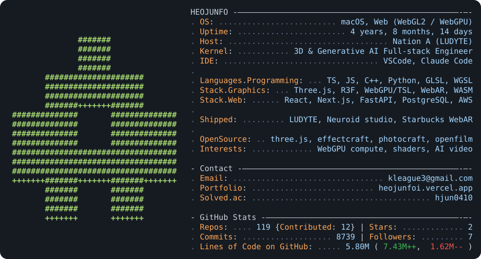

  <a href="https://heojunfoi.vercel.app">
    <picture>
      <source media="(prefers-color-scheme: dark)" srcset="dark_mode.svg">
      <source media="(prefers-color-scheme: light)" srcset="light_mode.svg">
      
    </picture>
  </a>

   

  <a href="https://gitranks.com/profile/HEOJUNFO/ranks"><picture><source media="(prefers-color-scheme: dark)" srcset="https://gitranks.com/badge/user/HEOJUNFO/rank.svg?by=contributions&theme=dark"></picture></a>
  <a href="https://gitranks.com/profile/HEOJUNFO/ranks"><picture><source media="(prefers-color-scheme: dark)" srcset="https://gitranks.com/badge/user/HEOJUNFO/rank.svg?by=contributions&scope=country&theme=dark"></picture></a>
   
  <a href="https://gitranks.com/profile/HEOJUNFO/ranks"><picture><source media="(prefers-color-scheme: dark)" srcset="https://gitranks.com/badge/user/HEOJUNFO/tier.svg?by=contributions&extra=level&theme=dark"></picture></a>
  <a href="https://gitranks.com/profile/HEOJUNFO/ranks"><picture><source media="(prefers-color-scheme: dark)" srcset="https://gitranks.com/badge/user/HEOJUNFO/goal.svg?by=contributions&theme=dark"></picture></a>

  <a href="https://gitranks.com/profile/HEOJUNFO/ranks"><picture><source media="(prefers-color-scheme: dark)" srcset="https://gitranks.com/badge/user/HEOJUNFO/count-chart.svg?by=contributions&theme=dark"></picture></a>

  Card based on <a href="https://github.com/AhmadHassan-BTed/AhmadHassan-BTed">AhmadHassan-BTed</a>

